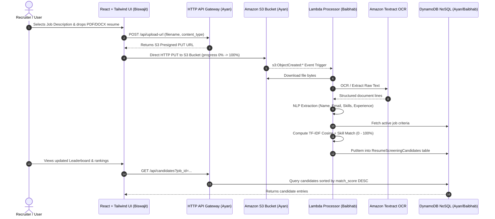

# Automated AI Resume & Document Screening Pipeline

[](https://github.com/Ayan9405/cloud-resume-screening/actions)


An enterprise-grade, event-driven serverless cloud computing project that automates resume ingestion, OCR document parsing, NLP skill and qualification extraction, and multi-factor semantic candidate ranking.

---

## 👥 3-Person Team Breakdown & Responsibilities

| Team Member | Subsystem | Core Responsibilities |
| :--- | :--- | :--- |
| **Biswajit Saha**<br>`@BiswajitSaha-45` | `/frontend` | **Frontend Engineering & UI/UX**: React 18 dashboard, Tailwind CSS glassmorphism, Job Description panel, direct S3 Presigned URL upload client with real-time progress bar, Candidate Leaderboard table with search/filters, and detailed score breakdown modal. |
| **Baibhab Sarkar**<br>`@Baibhabsarkar41` | `/backend` | **Cloud Backend & Machine Learning**: Python serverless functions, Amazon Textract OCR document parser (PDF/DOCX), NLP entity/skill extractor (contact, tech taxonomy, experience), TF-IDF vector cosine matching engine, and DynamoDB NoSQL CRUD persistence. |
| **Ayan Bag**<br>`@Ayan9405` | `/infrastructure` | **Cloud Infrastructure & DevOps**: Terraform IaC configurations, S3 Bucket with browser CORS & event triggers, DynamoDB tables with GSI indexes, least-privilege IAM policies, HTTP API Gateway v2, and GitHub Actions CI/CD deployment pipeline. |

---

## 🏛️ System Architecture



---

## 📂 Project Directory Structure

```
Resume-Screening-Cloud-Project/
├── .github/
│   └── workflows/
│       └── deploy.yml           # Automated CI/CD (Tests, Lint, Terraform Apply)
├── frontend/                    # Biswajit's Part
│   ├── public/
│   │   └── favicon.svg
│   ├── src/
│   │   ├── components/
│   │   │   ├── Header.jsx
│   │   │   ├── StatsOverview.jsx
│   │   │   ├── JobDescriptionPanel.jsx
│   │   │   ├── ResumeUploader.jsx
│   │   │   ├── CandidateLeaderboard.jsx
│   │   │   └── CandidateDetailModal.jsx
│   │   ├── services/
│   │   │   ├── api.js           # S3 Presigned URL + REST API client
│   │   │   └── mockData.js      # Offline demo fallback dataset
│   │   ├── App.jsx
│   │   ├── main.jsx
│   │   └── index.css            # Tailwind directives & glassmorphism
│   ├── index.html
│   ├── package.json
│   ├── tailwind.config.js
│   ├── vite.config.js
│   └── README.md
├── backend/                     # Baibhab's Part
│   ├── handlers/
│   │   ├── s3_trigger_handler.py    # S3 ObjectCreated Lambda event handler
│   │   ├── presigned_url_handler.py # S3 Presigned PUT URL generator
│   │   ├── candidates_handler.py    # Leaderboard & candidate CRUD API
│   │   └── jobs_handler.py          # Job descriptions management API
│   ├── services/
│   │   ├── document_parser.py       # Amazon Textract OCR & PDF/DOCX fallback
│   │   ├── nlp_extractor.py         # Entity & skill extractor (contact, tech taxonomy)
│   │   ├── matching_engine.py       # TF-IDF cosine similarity & weighted scoring
│   │   └── dynamodb_service.py      # NoSQL CRUD with local fallback store
│   ├── sample_data/
│   │   ├── sample_jobs.json
│   │   └── sample_resumes.json
│   ├── tests/
│   │   ├── run_tests.py             # Standalone test runner
│   │   ├── test_document_parser.py
│   │   ├── test_nlp_extractor.py
│   │   ├── test_matching_engine.py
│   │   └── test_api.py
│   ├── local_server.py              # FastAPI server simulating AWS locally
│   ├── requirements.txt
│   ├── requirements-dev.txt
│   └── README.md
├── infrastructure/              # Ayan's Part
│   ├── terraform/
│   │   ├── main.tf                  # AWS Provider & backend config
│   │   ├── variables.tf             # Configurable variables
│   │   ├── outputs.tf               # Bucket, API Gateway, table outputs
│   │   ├── s3.tf                    # S3 bucket, CORS, Lifecycle, S3 Event Notification
│   │   ├── dynamodb.tf              # Candidates (with GSI) & Jobs tables
│   │   ├── iam.tf                   # Least-privilege IAM execution roles
│   │   ├── lambda.tf                # Processor & API Lambda functions
│   │   ├── apigateway.tf            # HTTP API Gateway v2, CORS, routes
│   │   └── terraform.tfvars.example
│   ├── scripts/
│   │   ├── package_lambdas.py       # Lambda zip artifact packager
│   │   ├── deploy.ps1               # 1-Click PowerShell deployer
│   │   └── deploy.sh                # 1-Click Bash deployer
│   └── README.md
└── README.md
```

---

## ⚡ Quickstart: Local Development (Zero Cloud Spend)

The team can run and demo the full system locally without needing active AWS credentials:

### 1. Start the Backend API Server
```powershell
# Open Terminal 1
python backend/local_server.py
```
- API starts at `http://localhost:8000`
- Interactive Swagger documentation at `http://localhost:8000/docs`

### 2. Start the Frontend React Dashboard
```powershell
# Open Terminal 2
cd frontend
npm install
npm run dev
```
- Frontend starts at `http://localhost:3000` (or `http://localhost:5173`)

### 3. Run the Backend Unit Tests
```powershell
python backend/tests/run_tests.py
```

---

## ☁️ Cloud Deployment to AWS (Ayan's Guide)

### 1. Prerequisites
- Configured AWS CLI (`aws configure`) with credentials for your AWS account.
- Terraform CLI (v1.5.0+).

### 2. Deploy Infrastructure with Terraform
```bash
cd infrastructure/terraform

# Initialize Terraform AWS provider
terraform init

# Review execution plan
terraform plan

# Provision all cloud resources
terraform apply -auto-approve
```

### 3. Configure Frontend with Cloud API Gateway
Copy the `api_gateway_endpoint` output from Terraform and set it in `frontend/.env`:
```ini
VITE_API_URL=https://<api-id>.execute-api.us-east-1.amazonaws.com
```

### 4. Build and Deploy Frontend
```bash
cd frontend
npm install
npm run build
# Sync dist folder to S3 static hosting or CloudFront
aws s3 sync dist/ s3://<frontend-bucket-name> --delete
```

---

## 🧪 Candidate Fit Scoring Formula

The matching engine calculates an intuitive 0–100% composite score:

$$\text{Final Score} = (\text{Skill Match} \times 0.45) + (\text{Semantic Cosine} \times 0.40) + (\text{Tenure Ratio} \times 0.15)$$

- **Skill Match (45%)**: Overlap between extracted candidate skills and mandatory (75%) + preferred (25%) required skills.
- **Semantic Cosine (40%)**: Cosine similarity between TF-IDF n-gram vectors of the resume and job description.
- **Tenure Ratio (15%)**: Verified years of candidate experience relative to minimum job tenure.

---

## 📡 REST API Reference

| Method | Endpoint | Description |
| :--- | :--- | :--- |
| `POST` | `/api/upload-url` | Generate S3 Presigned PUT URL for direct browser document upload |
| `GET` | `/api/candidates` | Retrieve candidate leaderboard sorted by `match_score` descending |
| `GET` | `/api/candidates/{id}` | Get detailed candidate breakdown, extracted skills, and snippets |
| `DELETE` | `/api/candidates/{id}` | Delete candidate record from DynamoDB |
| `POST` | `/api/candidates/rescore` | Batch recalculate all candidate scores against active job description |
| `GET` | `/api/jobs` | List all available job descriptions |
| `GET` | `/api/jobs/active` | Get currently active screening job description |
| `POST` | `/api/jobs` | Create or update job requirements |
